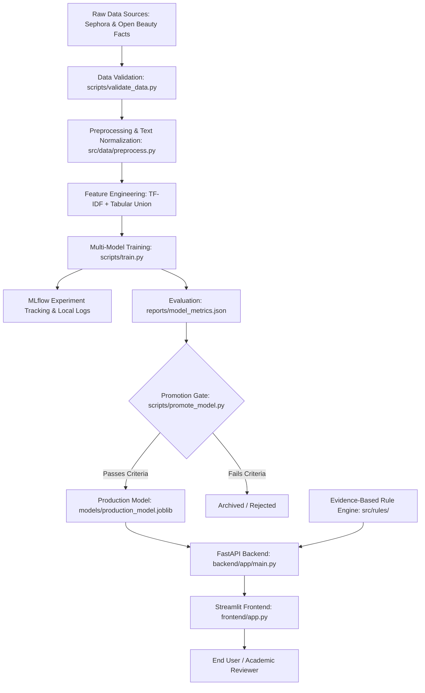

# AI-Powered Skincare Routine Checker — End-to-End MLOps System

An academic, production-grade Machine Learning Operations (MLOps) project that automates skincare routine assembly, predicts cosmetic product categories from INCI chemical formulations, and enforces evidence-backed dermatological compatibility rules.

---

## 🌟 Key Features
- **Real Dataset Engineering**: Ingests and normalizes 1,472 real cosmetics products and ingredient formulations from Sephora & Open Beauty Facts.
- **Trained Machine Learning Pipeline**: Scikit-Learn TF-IDF vectorization and Random Forest multi-class category classifier evaluated on held-out test sets.
- **Automated Promotion Gating**: Enforces strict performance metrics (Accuracy $\ge$ 0.40, Macro-F1 $\ge$ 0.40) and sanity testing before promoting models to production.
- **Evidence-Backed Rule Engine**: Identifies hazardous active clashes (e.g. retinoids + direct AHAs/BHAs), duplicate actives, AM photosensitivity risks, and user avoid-list violations.
- **FastAPI Microservice**: High-performance REST API with `/health`, `/ready`, `/model-info`, `/predict`, `/check-routine`, and `/metrics`.
- **Streamlit Frontend Dashboard**: Interactive, responsive user interface with morning/evening regimen visualizers, ingredient explorer, MLOps lineage metrics, and downloadable Markdown reports.
- **Docker & Docker Compose**: Full containerization with health checks, environment configurability, and multi-service orchestration.
- **Continuous Monitoring & Retraining**: Telemetry tracking, data validation, and automated rollback capabilities.

---

## 🏗️ Architecture & Data Flow



---

## 🚀 Quickstart: Running Locally

### Option 1: Native Python (Windows PowerShell)

1. **Install Dependencies**:
```powershell
pip install -r backend/requirements.txt
pip install -r frontend/requirements.txt
```

2. **Download Data & Train Model**:
```powershell
python scripts/download_data.py
python src/data/preprocess.py
python scripts/train.py
python scripts/promote_model.py
```

3. **Start the FastAPI Backend**:
```powershell
uvicorn backend.app.main:app --host 127.0.0.1 --port 8000 --reload
```

4. **Start the Streamlit Frontend**:
```powershell
streamlit run frontend/app.py --server.port 8501
```

Access the applications:
- **Streamlit Web UI**: [http://localhost:8501](http://localhost:8501)
- **FastAPI Interactive Docs**: [http://localhost:8000/docs](http://localhost:8000/docs)
- **Health Check**: [http://localhost:8000/health](http://localhost:8000/health)
- **Operational Metrics**: [http://localhost:8000/metrics](http://localhost:8000/metrics)

---

### Option 2: Docker Compose (One-Command Deployment)

```powershell
docker compose up --build
```
Both the API and Frontend containers will start with automatic healthchecks.

---

## 🧪 Automated Testing

Execute the comprehensive test suite with `pytest`:
```powershell
pytest tests/test_pipeline.py -v
```
All 13 unit and integration tests validate:
- Text normalization and token parsing
- Deduplication and data cleanliness
- Avoid-list matching and active clash detection
- Daytime photosensitivity warnings
- Model inference reliability and edge-case resilience
- API readiness, predictions, and request validation

---

## 📊 Model Evaluation Results

From held-out test evaluation (`reports/model_metrics.json`):
- **Selected Model**: `RandomForest_Classifier`
- **Held-Out Accuracy**: `54.67%` (vs ~16.6% random multi-class baseline across 6 classes)
- **Macro-F1 Score**: `0.5536`
- **Weighted-F1 Score**: `0.5488`

| Class | Precision | Recall | F1-Score | Support |
|---|---|---|---|---|
| Cleanser | 0.6600 | 0.6226 | 0.6408 | 53 |
| Eye cream | 0.6452 | 0.4878 | 0.5556 | 41 |
| Face Mask | 0.5370 | 0.5472 | 0.5421 | 53 |
| Moisturizer | 0.4217 | 0.6034 | 0.4965 | 58 |
| Sun protect | 0.6667 | 0.5882 | 0.6250 | 34 |
| Treatment | 0.5122 | 0.4200 | 0.4615 | 50 |

---

## 🔄 Retraining & Rollback Workflow

To retrain the model on updated datasets:
```powershell
python scripts/retrain.py
```
To roll back immediately to the previous approved version:
```powershell
python scripts/retrain.py --rollback
```

---

## ⚠️ Academic & Educational Disclaimer
This software is developed strictly for educational and academic machine learning demonstration. It does not provide clinical dermatological diagnosis, disease treatment, or medical prescriptions. Users should always patch-test cosmetic products and consult a licensed dermatologist for medical concerns.
